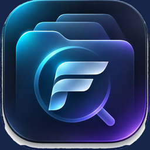
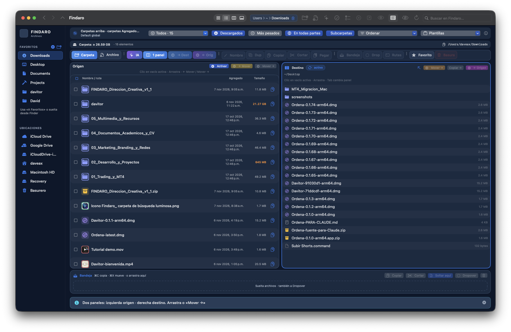
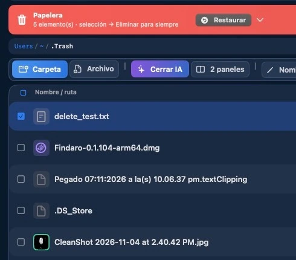

<h1>📁 FINDARO</h1>

<strong>Tus archivos, bajo control.</strong>

Gestor de archivos nativo para Mac con doble panel, cortar y pegar, 
fusión segura de carpetas y herramientas de inteligencia artificial local.

<a href="https://findaro.iareal.net/?lang=es">Sitio oficial</a> · <a href="https://findaro.iareal.net/probar?lang=es">Prueba gratis 5 días</a> · <a href="https://findaro.iareal.net/comprar?lang=es">Comprar licencia</a> · <a href="mailto:soporte@findaro.iareal.net">Soporte</a>

<strong>Español</strong> | <a href="README.md">English</a>

  

## ✨ ¿Por qué FINDARO?

Finder viene incluido con macOS, pero mover archivos entre carpetas, seguir los elementos copiados y gestionar conflictos entre carpetas exige varios pasos.

FINDARO mantiene **Origen y Destino a la vista**. Mueve archivos con **⌘X / ⌘V**, revisa los conflictos antes de fusionar carpetas y encuentra elementos dentro de subcarpetas. Está dirigido a personas que organizan y transfieren archivos con frecuencia.

## 📲 Descarga

**[→ Comenzar la prueba gratis de 5 días](https://findaro.iareal.net/probar?lang=es)**

- **Equipos compatibles:** Mac con Apple Silicon (ARM64).
- **Sistema requerido:** macOS 15 o posterior.
- **Prueba:** 5 días para una Mac, sin tarjeta bancaria. El sitio solicita nombre y correo electrónico para emitir la licencia de prueba y el enlace del instalador.
- **Licencias de pago:** Compra única con opciones para dos o cinco Macs. Consulta las [ofertas vigentes](https://findaro.iareal.net/comprar?lang=es) y los [términos](https://findaro.iareal.net/terminos).
- **Distribución:** El sitio oficial facilita el instalador de FINDARO. La aplicación consulta el servidor para licencias y actualizaciones. Las operaciones con tus archivos se realizan en la Mac.

### Instalación

1. Entra en la [página de prueba oficial](https://findaro.iareal.net/probar?lang=es).
2. Escribe tu nombre y correo. Solicita la prueba y conserva la licencia y el enlace de descarga recibidos.
3. Descarga el archivo `.dmg`, ábrelo e instala Findaro en **Aplicaciones**.
4. Abre Findaro. Si solicitaste una licencia desde la web, introdúcela en **Ajustes → Licencia**, según las instrucciones.
5. Elige tus carpetas de Origen y Destino y comienza a mover o copiar archivos.

**Distinción necesaria:** las publicaciones de GitHub Releases de este repositorio corresponden a versiones anteriores de **Ordena**, no a instaladores de FINDARO. Para FINDARO, entra en el [sitio oficial](https://findaro.iareal.net/?lang=es).

## 🚀 Cómo funciona

1. **Abre tus carpetas.** Navega con la barra lateral, las rutas, las pestañas o el campo de ubicación **⌘L**.
2. **Activa dos paneles.** Mantén una carpeta de Origen junto a la de Destino.
3. **Selecciona archivos.** Haz clic, ⌘ + clic, Shift + clic o selecciona mediante arrastre.
4. **Mueve o copia.** Pulsa **⌘X** para cortar, **⌘C** para copiar y **⌘V** para pegar. También puedes arrastrar entre paneles o elegir las acciones de transferencia.
5. **Revisa los conflictos.** En Smart Merge, examina la vista previa antes de autorizar una fusión de carpetas.
6. **Busca y restaura.** Filtra archivos, busca en subcarpetas o recupera elementos compatibles desde la Papelera. Abre **Ayuda → Ayuda de Findaro** para consultar la guía integrada.

## 📖 Guías

### Para quienes utilizan FINDARO
- **Ayuda integrada:** en Findaro, entra en **Ayuda → Ayuda de Findaro** (⌘?). Incluye doble panel, selección, pestañas, búsqueda, atajos y asistente local.
- [Sitio oficial](https://findaro.iareal.net/?lang=es)
- [Política de privacidad](https://findaro.iareal.net/privacidad)
- [Términos de licencia](https://findaro.iareal.net/terminos)
- [Política de reembolso](https://findaro.iareal.net/reembolso)
- [Soporte por correo](mailto:soporte@findaro.iareal.net)

### Documentación técnica
- [Reglas y límites de búsqueda](docs/SEARCH-RULES.md)
- [Lista de pruebas manuales](docs/CHECKLIST_MANUAL_FINDARO.md)
- [Especificación UX/UI](docs/creative/FINDARO_Direccion_Creativa_v1_1/UX_UI_SPEC.md)
- [Configuración del paquete Swift](Package.swift)

El repositorio también conserva documentos históricos de beta privada. No sustituyen al instalador público vigente.

## 🔧 Funcionalidades

### Navegación
- **Doble panel:** Origen y Destino visibles, con botones directos para copiar y mover.
- **Pestañas y ventanas:** Varias ubicaciones, historial de navegación y reordenamiento de pestañas.
- **Vista de lista e iconos:** Exploración con rutas, accesos rápidos y controles para archivos ocultos.
- **Actualización automática:** Detección de cambios en carpetas mediante FSEvents.

### Operaciones y protección
- **Cortar, copiar y pegar:** Atajos familiares y bandeja visible.
- **Transferencias por lotes:** Cola para operaciones con múltiples elementos.
- **Smart Merge:** Vista previa de conflictos y verificaciones de integridad SHA-256 al fusionar carpetas, con mecanismos documentados de recuperación.
- **Papelera:** Envía elementos a la Papelera de macOS y restaura los compatibles a su ubicación original.
- **Herramientas:** Renombrar, crear carpetas, previsualizar archivos y abrir Terminal en la carpeta actual.

### Búsqueda y organización
- **Filtro inmediato:** Reduce la lista de archivos de la carpeta actual.
- **Búsqueda recursiva por nombre:** Examina la carpeta actual y sus subcarpetas por coincidencia parcial, sin depender de Spotlight.
- **Orden y selección:** Distintos métodos de selección, ordenamiento y atajos personalizables.

### Asistencia local opcional
- **Asistente integrado:** Consultas de archivos y espacio mediante reglas locales.
- **Integración con Ollama:** Modelos locales opcionales para lenguaje natural y búsqueda de contenido de archivos de texto.
- **Tratamiento de datos:** El contenido de los archivos se procesa localmente. Las licencias, pruebas y actualizaciones se comunican con el servicio según la [política de privacidad](https://findaro.iareal.net/privacidad).

### Apariencia e idiomas
- Interfaz en **español e inglés**.
- Apariencia **clara y oscura**.

### Funciones no disponibles actualmente
Las integraciones con SFTP, Amazon S3, Google Drive y Dropbox están fuera del alcance actual documentado. No se anuncian como funcionalidades implementadas.

  

## ❓ ¿Primera vez en GitHub?

**No necesitas GitHub para instalar FINDARO.** Accede a la [prueba oficial](https://findaro.iareal.net/probar?lang=es) o al [sitio web](https://findaro.iareal.net/?lang=es).

Si deseas explorar el repositorio:

1. Pulsa **Code → Download ZIP** para consultar el código y los documentos. Ese ZIP **no es el instalador** de macOS.
2. Selecciona un archivo, por ejemplo [`docs/SEARCH-RULES.md`](docs/SEARCH-RULES.md), para leerlo.
3. Entra en **Releases** únicamente si necesitas versiones anteriores de **Ordena**. No descargues Ordena esperando instalar FINDARO.

Las personas desarrolladoras pueden consultar [`Package.swift`](Package.swift) y [`Sources/`](Sources/). Compilar el código es distinto de obtener una licencia y un instalador oficial.

## ❗ Acerca del proyecto

FINDARO es un gestor de archivos nativo para macOS, desarrollado con Swift y SwiftUI. El nombre comercial es **FINDARO**; el repositorio se llama `orden` y el ejecutable Swift conserva internamente el nombre `Orden`.

- [Sitio oficial](https://findaro.iareal.net/?lang=es)
- [Repositorio de código](https://github.com/gabrieldave/orden)
- [Soporte](mailto:soporte@findaro.iareal.net)

## 📜 Licencia

FINDARO se distribuye bajo sus [términos de licencia comercial](https://findaro.iareal.net/terminos). **Este repositorio no contiene un archivo LICENSE de código abierto.** La visibilidad pública del código no concede por sí misma permiso para copiar, modificar ni redistribuir el programa.

Consulta la [política de privacidad](https://findaro.iareal.net/privacidad) para conocer los datos relacionados con activación y periodo de prueba.
