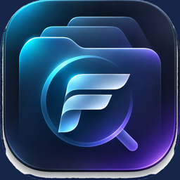
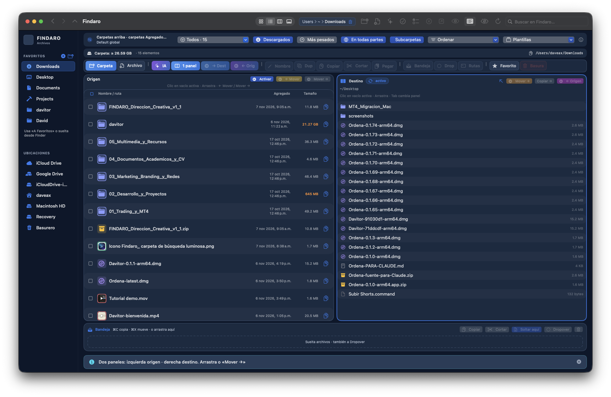
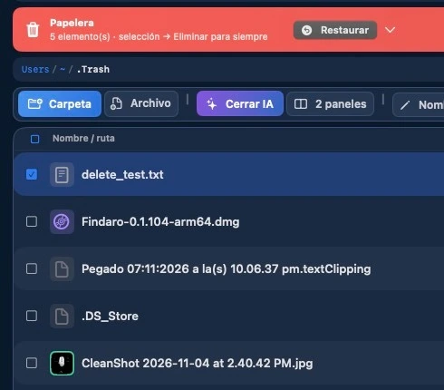

<h1>📁 FINDARO</h1>

<strong>Your files, under control.</strong>

A native file manager for Mac with dual-pane navigation, familiar cut and paste, 
safer folder merging and local AI tools in one workspace.

<a href="https://findaro.iareal.net/?lang=en">Official website</a> · <a href="https://findaro.iareal.net/probar?lang=en">Try free for 5 days</a> · <a href="https://findaro.iareal.net/comprar?lang=en">Buy a license</a> · <a href="mailto:support@findaro.iareal.net">Support</a>

<a href="README.es.md">Español</a> | <strong>English</strong>

  

## ✨ Why FINDARO?

Finder is included with macOS, but moving files between different folders, keeping track of copied items and handling folder conflicts can involve extra steps.

FINDARO keeps **Source and Destination side by side**. Move files with familiar **⌘X / ⌘V**, preview conflicts before merging folders and find files across subfolders. It is designed for people who regularly organize, transfer and review files on their Mac.

## 📲 Download

**[→ Start your free 5-day trial](https://findaro.iareal.net/probar?lang=en)**

- **Supported devices:** Macs with Apple Silicon (ARM64).
- **System requirement:** macOS 15 or later.
- **Trial:** 5 days for one Mac, with no credit card required. The website requests your name and email address to issue a trial license and installer link.
- **Paid licenses:** One-time purchase options for two or five Macs. See [current offers](https://findaro.iareal.net/comprar?lang=en) and [terms](https://findaro.iareal.net/terminos).
- **Distribution:** The official FINDARO site provides its installer. The app checks a server for licensing and updates, while file-management operations run on your Mac.

### Installation

1. Open the [official trial page](https://findaro.iareal.net/probar?lang=en).
2. Enter your name and email, then request the trial. Keep the license key and download link provided.
3. Download the Findaro `.dmg`, open it and install Findaro in **Applications**.
4. Open Findaro. If you requested a trial key through the website, enter it in **Settings → License** as instructed.
5. Choose your Source and Destination folders, then begin moving or copying files.

**Important distinction:** GitHub Releases in this repository currently contain older **Ordena** builds. They are **not** presented here as FINDARO downloads. For FINDARO, follow the [official website](https://findaro.iareal.net/?lang=en).

## 🚀 How It Works

1. **Open your folders.** Browse with the sidebar, path bar, tabs or **⌘L** location field.
2. **Enable two panes.** Keep a Source folder visible alongside its Destination.
3. **Select files.** Use click, ⌘-click, Shift-click or drag selection.
4. **Move or copy.** Press **⌘X** to cut, **⌘C** to copy and **⌘V** to paste. You can also drag between panes or choose the dedicated transfer actions.
5. **Review folder conflicts.** Use Smart Merge when combining folder contents. Inspect the preview before approving changes.
6. **Find and restore.** Filter visible files, search subfolders, or restore supported items from the Trash. Use **Help → Findaro Help** for the built-in guide.

## 📖 Guides

### For FINDARO users
- **Built-in help:** In Findaro, open **Help → Findaro Help** (⌘?); topics include dual panes, selection, tabs, searching, shortcuts and the local AI assistant.
- [Official website](https://findaro.iareal.net/?lang=en)
- [Privacy policy](https://findaro.iareal.net/privacidad)
- [License terms](https://findaro.iareal.net/terminos)
- [Refund policy](https://findaro.iareal.net/reembolso)
- [Support by email](mailto:support@findaro.iareal.net)

### Technical documentation
- [Search behavior and limits](docs/SEARCH-RULES.md)
- [Manual test checklist](docs/CHECKLIST_MANUAL_FINDARO.md)
- [UX/UI specification](docs/creative/FINDARO_Direccion_Creativa_v1_1/UX_UI_SPEC.md)
- [Swift package configuration](Package.swift)

The repository also contains historical private-beta documents. They are not a substitute for the current public installer.

## 🔧 Features

### File navigation
- **Dual-pane workspace:** Source and Destination visible together, with direct copy and move actions.
- **Tabs and windows:** Multiple locations with navigation history and tab reordering.
- **List and icon views:** File browsing with path breadcrumbs, quick location access and hidden-file controls.
- **Automatic refresh:** FSEvents-based updates when folder contents change.

### File operations and safety
- **Cut, copy and paste:** Familiar keyboard workflow with a visible clipboard tray.
- **Batch transfers:** Queue-based operations for multiple items.
- **Smart Merge:** Conflict preview and SHA-256 integrity checks for folder merges, with documented recovery mechanisms.
- **Trash management:** Delete to macOS Trash and restore supported items to their original location.
- **File utilities:** Rename, create folders, preview files and open Terminal in the current folder.

### Search and organization
- **Live filtering:** Narrow the files visible in the current folder.
- **Recursive name search:** Search the current folder and its subfolders by partial filename, without depending on Spotlight.
- **Sorting and selection:** Multiple selection methods, sorting controls and configurable keyboard shortcuts.

### Optional local assistance
- **Built-in assistant:** Rules-based file and space queries.
- **Ollama integration:** Optional local language models for natural-language operations and text-content searches.
- **Privacy-aware processing:** File content is processed locally. Licensing, trial registration and update checks communicate with the service as described in the [privacy policy](https://findaro.iareal.net/privacidad).

### Appearance and language
- **English and Spanish** interface options.
- **Light and dark** appearance.

### Not currently offered
SFTP, Amazon S3, Google Drive and Dropbox integrations are outside the product's documented current scope. Do not treat planned integrations as shipped features.

  

## ❓ New to GitHub?

**You do not need GitHub to install FINDARO.** Use the [official trial page](https://findaro.iareal.net/probar?lang=en) or [website](https://findaro.iareal.net/?lang=en).

If you are exploring this repository:

1. Select **Code → Download ZIP** to inspect the source and documentation. This ZIP is **not** the macOS installer.
2. Select a filename, such as [`docs/SEARCH-RULES.md`](docs/SEARCH-RULES.md), to read it online.
3. Open **Releases** only if you specifically need the repository's earlier **Ordena** builds. Do not install an Ordena release expecting it to be FINDARO.

Developers can inspect [`Package.swift`](Package.swift) and the [`Sources/`](Sources/) directory. Building source code is separate from licensing and official distribution.

## ❗ About

FINDARO is a native macOS file manager written in Swift and SwiftUI. Its commercial name is **FINDARO**; the repository is named `orden` and its Swift executable target is internally named `Orden`.

- [Official website](https://findaro.iareal.net/?lang=en)
- [Source repository](https://github.com/gabrieldave/orden)
- [Support](mailto:support@findaro.iareal.net)

## 📜 License

FINDARO is distributed under its [commercial license terms](https://findaro.iareal.net/terminos). **No open-source LICENSE file is present in this repository.** Publicly visible source code does not, by itself, grant permission to copy, modify or redistribute the software.

For details on trial activation and data processing, read the [privacy policy](https://findaro.iareal.net/privacidad).
