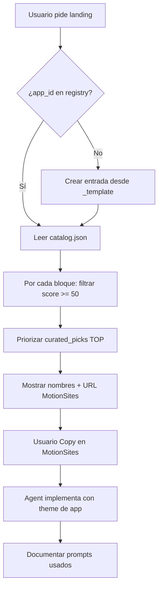

# Web Style Catalog — Guía para futuras apps VibeSystems

Guía para **ti** (humano) y para **Cursor AI** (agent). Objetivo: landings consistentes usando prompts MotionSites gratis.

---

## Resumen en 30 segundos

1. Cada app tiene un `app_id` en `apps.registry.json`
2. El catálogo (`catalog.json`) puntúa 200 prompts gratis por app y bloque
3. Cursor **debe leer el catálogo** antes de diseñar marketing UI
4. Tú copias el prompt en MotionSites; Cursor adapta al producto

---

## Estructura de archivos

```
~/.cursor/skills/web-style-catalog/
├── SKILL.md              ← Cursor lo lee automáticamente (description amplia)
├── reference.md          ← Esta guía
├── apps.registry.json    ← TUS apps + theme + TOP picks
├── catalog.json          ← 200 items enriquecidos (generado)
├── enrich-catalog.py     ← Regenera catalog.json
└── index.html            ← Buscador visual
```

Regla global Cursor: `~/.cursor/rules/vibesystems-web-style-catalog.mdc`

---

## Alta de app nueva (checklist)

### 1. Crear entrada en registry

Edita `apps.registry.json`. Copia `_template`:

```json
"mi-crm": {
  "label": "Mi CRM — ventas B2B",
  "tags": ["saas-ai", "b2b", "dark"],
  "avoid": ["crypto", "luxury", "edtech"],
  "theme": {
    "bg": "#0a0e17",
    "accent": "#3b82f6",
    "violet": "#8b5cf6",
    "ink": "#e2e8f0"
  },
  "repo_hint": "Projects/mi-crm",
  "landing_css": "src/app/landing.css",
  "curated_picks": {
    "hero": ["Power AI", "Sentinel AI"],
    "features": ["Glow Features"],
    "pricing": ["Rocket Pricing"],
    "footer": ["Stark Minimal Footer"]
  }
}
```

**tags** — qué estilos MotionSites suman puntos  
**avoid** — qué tags restan puntos (vertical incorrecta)  
**curated_picks** — tus favoritos verificados (badge TOP)

### 2. Regenerar catálogo

```bash
python3 ~/.cursor/skills/web-style-catalog/enrich-catalog.py
```

### 3. Regla en el repo (opcional pero recomendado)

Crea `.cursor/rules/web-style-catalog.mdc`:

```markdown
---
description: Landing/marketing — usar app_id mi-crm en web-style-catalog
globs: "**/landing.css"
alwaysApply: false
---

App ID: mi-crm
Consultar ~/.cursor/skills/web-style-catalog/ antes de diseñar UI marketing.
```

### 4. Primera landing con Cursor

Pega en Agent:

```
App: mi-crm
Usa el skill web-style-catalog.
Necesito landing con: hero, features, pricing, faq, footer.
Propón TOP picks, dime qué copiar en MotionSites, implementa en src/app/
Usa theme de apps.registry.json.
```

---

## Bloques de landing (glosario)

| Bloque | Uso típico |
|--------|------------|
| `hero` | Above the fold + CTA principal |
| `features` | Beneficios / valor (grid de cards) |
| `process` | Pasos / cómo funciona |
| `pricing` | Planes y precios |
| `testimonials` | Reviews + stats |
| `faq` | Preguntas frecuentes |
| `cta` | Cierre antes del footer |
| `footer` | Links legales + logo |
| `background` | Glow / video de fondo |
| `template-full` | Página entera precompuesta |
| `gallery` | Ejemplos / portfolio |

---

## Flujo Cursor AI (detallado)



---

## Criterios de selección (Agent)

| Prioridad | Criterio |
|-----------|----------|
| 1 | En `curated_picks[block]` |
| 2 | `app_scores[app_id] >= 70` |
| 3 | Tags coinciden con `tags` del app |
| 4 | `app_scores >= 50` como mínimo aceptable |
| ❌ | Tag en `avoid` → descartar aunque score alto |
| ❌ | Vertical claramente ajena (ej. NFT para edtech) |

---

## Integración con ecosistema VibeSystems

- Leer **después** de `Ecosistema.html` y reglas de seguridad
- Landings en Next.js: `output standalone`, healthcheck, sin secretos en repo
- Colores del **theme registry** > colores del prompt MotionSites
- Misma app = mismos bloques TOP en todas sus páginas públicas (consistencia)

---

## Mantenimiento

| Frecuencia | Acción |
|------------|--------|
| Nueva app | Entrada en `apps.registry.json` + regenerar |
| Rediseño mayor | Revisar `curated_picks` con index.html |
| MotionSites actualiza | Regenerar `motionsites-gratis.json` + enrich |
| Prompt nuevo favorito | Añadir a `curated_picks` del app_id |

---

## Ejemplos por tipo de app

| Tipo | app_id sugerido | Heroes TOP típicos |
|------|-----------------|-------------------|
| Edtech / cursos | `cursia` | 3D Portfolio, DesignPro Academy |
| SaaS IA | `saas-ai` | Power AI, Stellar AI, Nexora Automation |
| Agencia | `agency` | Velorah, Creative Studio |
| Academia online | `edtech` | CodeNest, Mindloop Landing |
| Sin perfil aún | `generic` | Filtrar por score manualmente |

---

## Troubleshooting

**Cursor no usa el catálogo** → Di explícito: `Usa skill web-style-catalog` o `@web-style-catalog`

**Score bajo para mi app** → Ajusta `tags`/`avoid` en registry y añade `curated_picks`

**index.html no carga JSON** → Abrir desde la misma carpeta; o usar `catalog.json` directo en Agent

**Prompt Premium en MotionSites** → Elegir otro del mismo bloque con `access: Copy`
